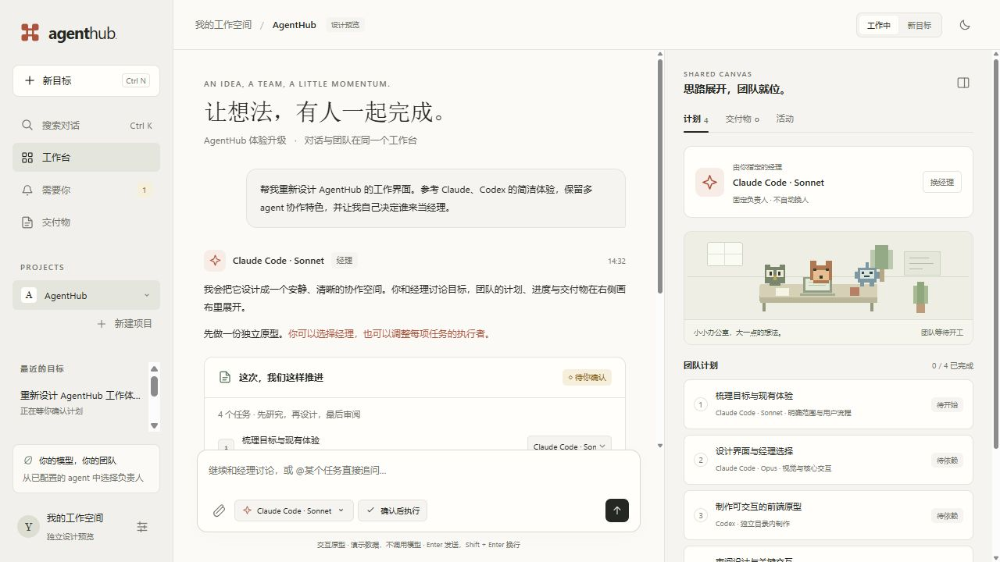
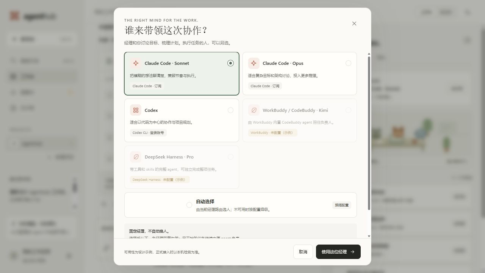
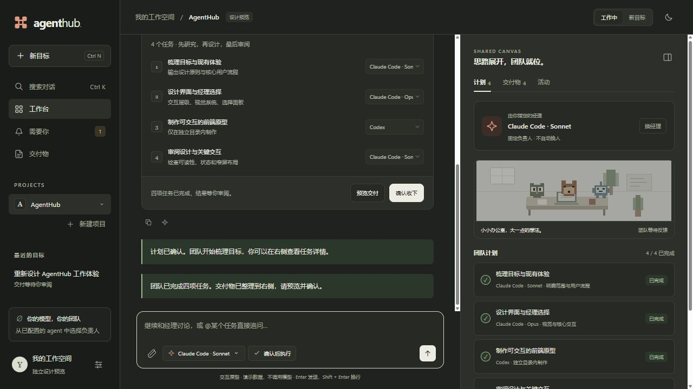
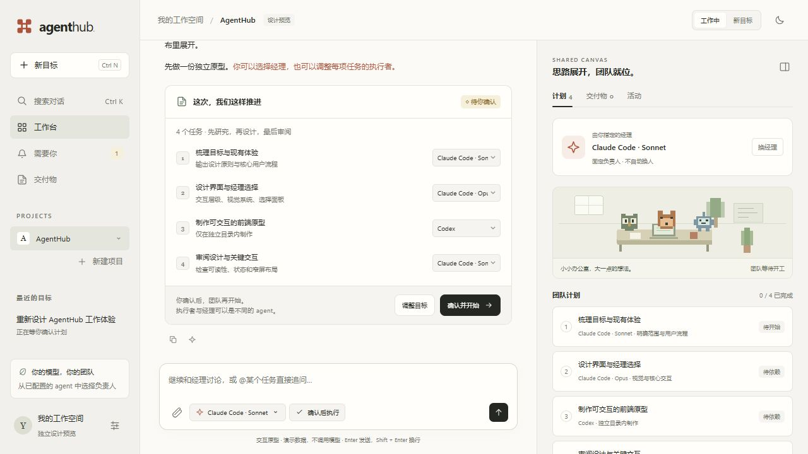
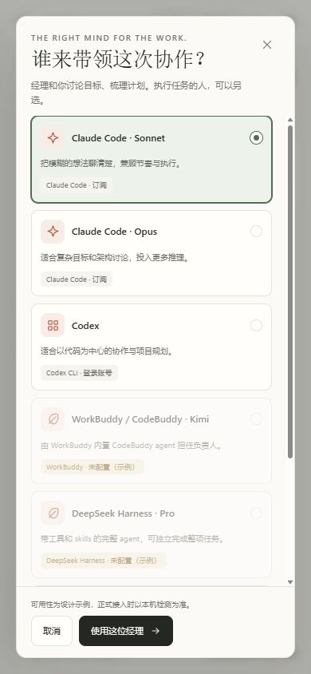
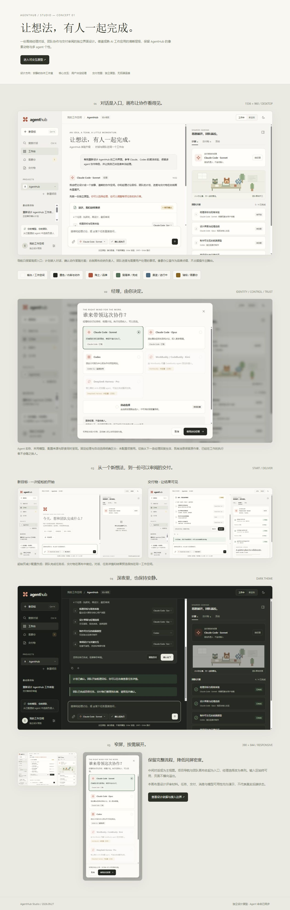

# AgentHub

**你的目标，你的 Agent 团队。**

AgentHub 是本地运行的多 Agent 协作工作台。先与经理澄清目标，再把目标拆成任务依赖图，交给不同 Agent 执行，并在像素办公室里查看进度、任务、交付物和运行记录。

支持 Claude Code、Codex CLI、WorkBuddy / CodeBuddy、DeepSeek Harness，以及用户自建的 OpenAI 兼容、Anthropic 和 OpenRouter 格式 API 连接。各执行器需要用户自行安装、登录或提供密钥；AgentHub 不提供账号、模型额度或托管凭证。

## 界面原型

以下为已确认的 **Studio 设计原型**：左侧会话，中间经理对话，右侧团队画布。用户可以决定谁担任经理。





<details>
<summary>查看暗色主题、移动端与完整设计画布</summary>









</details>

这些图片使用演示数据，是设计参考。**当前公开代码已包含 Studio 三栏工作台，以及 Agent、模型与思考程度选择。** 实际可选模型、权限和进度取决于用户接入的 Agent 版本与配置。

## 已有能力

- 经理对话澄清目标，AI 规划或 JSON 计划输入。
- 按任务类型、难度与专长路由，支持降级链和失败重试。
- DAG 并行调度、上游上下文接力、共享黑板与 JSONL 事件流。
- 自动或手动分配执行者，计划确认及写盘任务确认。
- 像素办公室、运行历史、思考与行动记录、浅色与暗色主题。
- 文件和改动预览、交付物导出、运行取消、崩溃恢复与过期任务重跑。
- Claude Code 任务完成后继续追问；其他执行器的续聊能力仍有边界。
- 本机 Agent 发现、用户选择接入、安装和登录检查；支持的 CLI 可读取实际模型目录。目录条目和真实调用测试状态分别显示。
- 自定义 API 连接、分类设置、Windows 系统文件夹选择及带加载反馈的图标操作。
- 运行中创建新目标并排队，轮到后经理澄清、用户确认再执行；会话持久化与恢复。
- 文件检查点、逐文件改动审阅和回滚；会写工作区文件的任务串行执行。
- 消息复制、重发及修改回填，多选澄清，保留输入焦点与历史滚动位置。
- 规划阶段完整接收用户约束，按要求组织任务，区分已完成的启动确认与后续审批。

## 快速开始

核心运行需要 Python 3.9+；建议使用 Python 3.11+，以支持本机 Agent 检查中的 TOML 配置解析。项目使用普通 HTML / JavaScript 和 Python，无前端构建步骤。

```bash
git clone https://github.com/Yuhao1015/agenthub.git
cd agenthub
python -m venv .venv
```

macOS / Linux：

```bash
source .venv/bin/activate
pip install -r requirements.txt
cp hub/capability_matrix.example.yaml hub/capability_matrix.yaml
python main.py --plan example_plan.json --mock
python serve.py
```

Windows PowerShell：

```powershell
.\.venv\Scripts\python.exe -m pip install -r requirements.txt
Copy-Item hub/capability_matrix.example.yaml hub/capability_matrix.yaml
.\.venv\Scripts\python.exe main.py --plan example_plan.json --mock
.\.venv\Scripts\python.exe serve.py
```

打开 <http://localhost:8787/dashboard.html>。Mock 不需要账号或密钥。真实运行前，在设置中发现本机 Agent、勾选需要接入的工具并保存；检查安装和登录状态，再选择经理与工作区。API 连接由用户自行添加。只有用户明确选择某个模型并确认费用后，才执行模型可用性测试。

Windows 根目录提供 `launcher.bat`；系统 `python` 已安装上述依赖时可双击启动。使用虚拟环境时，优先使用上面的完整 Python 路径启动。

给出目标或直接运行计划：

```bash
python main.py --goal "设计一个简单的个人主页" --workdir ./workspace
python main.py --plan example_plan.json --workdir ./workspace
python main.py --plan example_plan.json --resume
```

上述真实运行可能消耗用户自己的订阅、积分或 API 额度。

## 本地配置与隐私

仓库只提供可移植的 `hub/capability_matrix.example.yaml` 示例。复制后的 `hub/capability_matrix.yaml` 属于本地文件，已忽略；按自己的 Agent、模型、路由与预算修改。

API 的名称、地址、协议格式和密钥在设置中由用户添加；旧执行器也支持其对应环境变量。Claude Code 和 Codex CLI 使用各自的登录状态。不要将密钥写入源码、示例配置或提交到 Git。

本次发布不包含个人配置、凭证、会话与运行数据、机器路径记录、内部实验和交接材料、虚拟环境、未提交修改及本地 Git 历史。`.gitignore` 同时覆盖常见本地配置和运行产物。

成本记录和预算护栏只覆盖可计量的付费 API 调用；订阅、积分和 DeepSeek Harness 的花费可能无法完整计量。订阅执行器记录金额为零不代表未消耗额度。CLI 已安装、已登录或目录中存在某个模型，都不等于该模型真实调用成功。

文件检查点覆盖工作区内被纳入快照的文件，不保证撤销网络操作或工作区外的改动。部分 Agent 不支持自动读取目录或检查登录，界面会明确说明限制。

## 架构

```text
main.py / serve.py  →  Manager / Planner  →  Plan（任务 DAG）
                                              ↓
                                         Router → Executors
                                              ↓
                                Blackboard + JSONL 事件 → Dashboard
```

代码集中在 `hub/`。控制平面负责执行顺序，黑板保存任务事实和上下文；前端通过事件展示运行状态。运行说明见 [USAGE.md](USAGE.md)。

## 测试与贡献

测试使用可直接运行的 Python 脚本：

```bash
python tests/test_scheduler.py
python tests/test_router_metadata.py
python tests/test_plan_from_blackboard.py
```

请先复制示例矩阵。源版本 `db61350` 已完成 109 个 Python 回归脚本、7 组浏览器测试和一次真实 Codex 工作产出复测；这不代表所有平台或所有 Agent 均已实机验证。浏览器测试使用 Playwright，Python 测试使用模拟执行器，不应自动消耗模型额度。

公开代码源版本：`db613504d2641c6a260f85fa1d558876939b3031`。公开发布使用独立 Git 历史，不携带本地开发仓库历史或内部验收记录。

欢迎提交 Issue 或 Pull Request。开发中的分支不会自动并入公开版本；后续发布以完成并合入 `main` 的代码为准。

## 开源许可

[MIT License](LICENSE)。本项目与所接入的 Agent 服务没有官方隶属关系；第三方名称和服务仍受各自条款约束。
